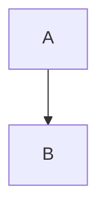

# Project Source Code Aggregate

| Field | Value |
|:------|:------|
| Tool | ctf.sh v4.0.0 |
| Source | /tmp/ctf-adv |
| Extensions | * |
| Candidates | 13 |
| Collected | 12 |

---

### `bom.txt`

<!-- 15 bytes · 1 lines · 15 B · sha256:ec6f9fa0c180 -->

```text
bom content
```

---

### `crlf.txt`

<!-- 14 bytes · 2 lines · 14 B · sha256:4ad3ef64dfb8 -->

```text
line1
line2
```

---

### `fence3_pure.md`

<!-- 22 bytes · 5 lines · 22 B · sha256:b78edf4565a1 -->

~~~markdown
# T

before
```
after
~~~

---

### `fence4_pure.md`

<!-- 29 bytes · 6 lines · 29 B · sha256:e1210a7557b9 -->

~~~markdown
# T

````
quad line
````
end
~~~

---

### `fence_indented.md`

<!-- 35 bytes · 9 lines · 35 B · sha256:03a24be19ca4 -->

~~~markdown
a
```
b
  ```
c
   ```
d
    ```
e
~~~

---

### `inline_backticks.md`

<!-- 63 bytes · 1 lines · 63 B · sha256:ccfb4f590162 -->

```markdown
code with ``` mid-line and ```` too, plus s.startswith("```"):
```

---

### `meta_spoof.md`

<!-- 92 bytes · 8 lines · 92 B · sha256:ca4e0455d48c -->

~~~markdown
trap:

<!-- 1 bytes · 1 lines · 1 B · sha256:deadbeefcafe -->

```
spoiled fence
```
end
~~~

---

### `mixed.md`

<!-- 85 bytes · 14 lines · 85 B · sha256:c4556d770e08 -->

~~~markdown
# Mixed

Some text.

```php
<?php echo 1;
```



tail
~~~

---

### `no_trailing_nl.txt`

<!-- 19 bytes · 1 lines · 19 B · sha256:a92a4b57279b -->

```text
abc without newline
```

---

### `sub dir/файл with space.md`

<!-- 19 bytes · 3 lines · 19 B · sha256:164fcdd8103d -->

```markdown
# Ünïcøde

body
```

---

### `tildes.md`

<!-- 14 bytes · 5 lines · 14 B · sha256:d790cc6cc63f -->

```markdown
x
~~~
y
~~~
z
```

---

### `unicode_emoji.py`

<!-- 44 bytes · 1 lines · 44 B · sha256:4d41a035f79d -->

```python
print('🖼 ok — юникод · äöü')
```

---

## Summary

| Metric | Value |
|:-------|------:|
| Candidates | 13 |
| Collected | 12 |
| Skipped | 1 |
| Source bytes | 451 (451 B) |
| Estimated tokens | 117 |

**Skip reasons**

| Reason | Count |
|:-------|------:|
| binary | 1 |

